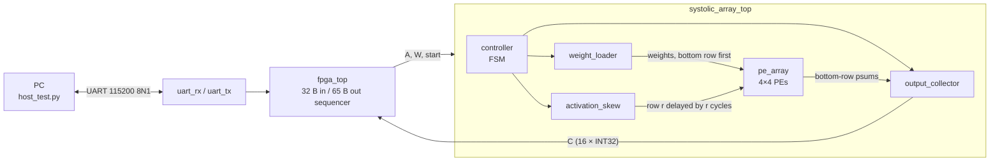

<div align="center">

# 4×4 INT8 Systolic Array Accelerator on iCE40UP5K

**A weight-stationary matrix multiplier on a low-cost FPGA, built with a fully open-source toolchain and verified on real hardware.**

[](https://github.com/<your-username>/systolic-array-ice40/actions/workflows/ci.yml)


<!-- [](https://youtu.be/YOUR_VIDEO_ID) -->

</div>

`C = A × W` for two 4×4 signed INT8 matrices, accumulated in 32 bits, computed by a 4×4 grid of processing elements and driven from a PC over UART. Every result is checked against NumPy on the real board.

Built for **TechXcelerate 2026** at KLE Technological University, Belagavi.
**Author:** Daksh Mavani · **Mentor:** Sushant

---

## Table of contents

1. [Why a systolic array?](#why-a-systolic-array)
2. [Highlights](#highlights)
3. [Architecture](#architecture)
4. [How it works](#how-it-works)
5. [Results](#results)
6. [Repository layout](#repository-layout)
7. [Getting started](#getting-started)
8. [Host protocol](#host-protocol)
9. [Hardware reference](#hardware-reference)
10. [Verification strategy](#verification-strategy)
11. [Design notes and limitations](#design-notes-and-limitations)
12. [Troubleshooting](#troubleshooting)
13. [Future scope](#future-scope)
14. [Acknowledgements](#acknowledgements)
15. [License](#license)

---

## Why a systolic array?

AI inference is dominated by matrix multiplication. A CPU spends much of its effort moving data to and from memory. In a systolic array, data is passed between neighbouring cells, so each value is fetched once and reused many times. The structure is regular, local and compact, which suits FPGA fabric well.

**Objective:** build a working 4×4 signed INT8 matrix multiplier (`C = A × W`, 32-bit accumulation) on a low-cost FPGA and verify it on hardware.

## Highlights

- 4×4 grid of 16 PEs, **signed INT8 × INT8 → INT32** accumulate
- Weight-stationary dataflow with on-chip weight preload
- **18 clock cycles (1.5 µs at 12 MHz)** from `start` to `done`
- UART host interface (115200 8N1) with a 100 ms frame timeout
- Cycle-accurate **Python golden model** that tags every value to self-check skew and timing
- Self-checking **Verilator testbenches**, including 100 random back-to-back runs without reset
- **55 / 55** results verified on a VSDSquadron FM board
- Open toolchain end to end (**Yosys → nextpnr-ice40 → IceStorm**) with CI

## Architecture



### Dataflow

```
          W col0   W col1   W col2   W col3        preload: shifts DOWN, bottom row first
             |        |        |        |
A row0 ->  PE00 -> PE01 -> PE02 -> PE03 ->         activations move RIGHT
             |        |        |        |
A row1 ->  PE10 -> PE11 -> PE12 -> PE13 ->         row r is delayed by r cycles
             |        |        |        |
A row2 ->  PE20 -> PE21 -> PE22 -> PE23 ->
             |        |        |        |
A row3 ->  PE30 -> PE31 -> PE32 -> PE33 ->
             v        v        v        v
          C[.][0]  C[.][1]  C[.][2]  C[.][3]       partial sums move DOWN
```

### Modules

| Module | File | Role |
|---|---|---|
| `processing_element` | `rtl/processing_element_yo.sv` | Holds one stationary weight. Registers the incoming activation, multiplies it by the weight and adds the partial sum from above |
| `pe_array` | `rtl/pe_array_yo.sv` | 4×4 grid of PEs. Activations flow right, partial sums flow down, weights shift down during preload |
| `weight_loader` | `rtl/weight_loader_yo.sv` | Feeds W into the top of each column, one row per cycle, bottom row first |
| `activation_skew` | `rtl/activation_skew_yo.sv` | Delays row *r* by *r* cycles so the wavefront lines up |
| `output_collector` | `rtl/output_collector_yo.sv` | Stores each column's results in order into the 4×4 result matrix and raises `done` |
| `controller` | `rtl/controller_yo.sv` | FSM that sequences preload, run, collect and done |
| `systolic_array_top` | `rtl/systolic_array_top_yo.sv` | Wires the controller, loader, skew, array and collector together |
| `uart_rx`, `uart_tx` | `rtl/uart_rx.v`, `rtl/uart_tx.v` | 8N1 UART, parameterised by clock frequency and baud rate |
| `fpga_top` | `fpga/fpga_top.sv` | Internal oscillator, power-on reset, UART sequencer, cycle counter, status LEDs |

## How it works

1. **Preload.** Weights stream in from the top of each column, bottom row first. After 4 cycles `PE(r,c)` holds `W[r][c]` and stays there for the whole multiply.
2. **Skewed feed.** Array row *r* receives `A[m][r]` at cycle `m + r`. This diagonal skew makes activation *m* meet partial sum *m* in every PE.
3. **Wavefront.** Each PE registers its activation, passes it right on the next cycle, and adds `act × weight` to the partial sum arriving from above.
4. **Collect.** Column *c* emits `C[0][c], C[1][c], C[2][c], C[3][c]` in order from the bottom row. The collector writes each into a fixed slot and raises `done` once all four columns hold four results.

### PE timing

```
psum_reg <= psum_in + sign_extend(act_reg * weight_reg)   // when act_valid_reg
act_reg  <= act_in                                        // forwarded right next cycle
```

The multiply uses the currently registered activation, so a value takes one cycle to be registered before it contributes to the sum.

### Cycle budget (reference waveform, 10 ns clock)

| Cycles | Phase | Notes |
|---|---|---|
| 4 | Preload | `weight_load_en` high, `preload_done` on the last cycle |
| 10 | Run | `activation_enable` and `collector_enable` high |
| 4 | Drain / handshake | last partial sums reach the collector, `collector_done`, then `done` |
| **18** | **Total** | matches the hardware cycle counter in `fpga_top.sv` |

The reference run is in [`docs/waves_top.vcd`](docs/waves_top.vcd); open it with GTKWave.

## Results

### Correctness

| Check | Result |
|---|---|
| Verilator: PE, PE array (53 tests), top level (104 tests) | PASS |
| Python golden model vs NumPy (directed, random, structural guards) | PASS |
| On hardware: `host_test.py -n 50` (5 directed + 50 random) | **55 / 55 PASS** |

Directed hardware tests: signed mix, identity, all −128 × −128, all 127 × −128, and zero activations.

### Performance

| Metric | Value |
|---|---|
| Clock | 12 MHz (internal `SB_HFOSC`) |
| Latency, `start` → `done` | **18 cycles = 1.5 µs** |
| Work per multiply | 4 × 4 × 4 = 64 MACs |
| Effective throughput | 64 / 18 ≈ **3.6 MAC/cycle** (≈ 43 MMAC/s) |
| Peak throughput (16 PEs busy) | 16 MAC/cycle = 192 MMAC/s |
| End-to-end over UART | ≈ 8.4 ms per multiply (97 bytes × 10 bits ÷ 115200 baud) |

The array itself finishes in microseconds, so the **UART link dominates end-to-end time**. Utilization is also low because each 4×4 multiply fills and drains the pipeline; continuous streaming (see [Future scope](#future-scope)) would amortize that.

### FPGA resources and timing

Fill these in from your own `make stat` and `make time` output.

| Resource | Used | Available (iCE40UP5K) |
|---|---|---|
| LUTs | _TBD_ | 5280 |
| Flip-flops | _TBD_ | 5280 |
| DSP blocks | _TBD_ | 8 |
| Fmax (icetime) | _TBD_ MHz | target 12 MHz |

## Repository layout

```
.
├── rtl/          # synthesizable design: PE, array, loader, skew, collector, controller, UART
├── fpga/         # fpga_top.sv and VSDSquadronFM.pcf pin constraints
├── tb/           # self-checking SystemVerilog testbenches
├── host/         # host_test.py: UART test against NumPy
├── model/        # cycle-accurate Python golden model
├── docs/         # ARCHITECTURE.md, reference waveform (VCD), project slides
├── media/        # demo video thumbnail, board photo, waveform screenshots
├── .github/      # CI workflow
├── Makefile      # sim, lint, build, flash, time, stat, test, model
└── requirements.txt
```

## Getting started

### Prerequisites

| Tool | Used for |
|---|---|
| [OSS CAD Suite](https://github.com/YosysHQ/oss-cad-suite-build) | Yosys, nextpnr-ice40, IceStorm (`icepack`, `icetime`, `iceprog`) |
| [Verilator](https://www.veripool.org/verilator/) 5.x | Simulation and lint |
| Python 3.9+ | `pip install -r requirements.txt` (NumPy, pySerial) |
| VSDSquadron FM board | Running on hardware |
| [GTKWave](https://gtkwave.sourceforge.net/) (optional) | Viewing waveforms |

### 1. Simulate (no hardware needed)

```bash
make sim      # runs all three testbenches
make lint     # Verilator lint
make model    # Python golden-model regression
```

`tb_systolic_array_top` writes `waves_top.vcd` into `build/sim/`.

### 2. Build and flash

```bash
make clean
make build            # yosys -> nextpnr -> icepack  =>  build/fpga_top.bin
make stat             # utilization from the Yosys log
make time             # icetime timing report
sudo make flash       # iceprog
```

### 3. Run the hardware test

Close any serial terminal (for example picocom) first; only one program can own the port.

```bash
python3 host/host_test.py -p /dev/ttyUSB0 -n 50
# or
make test PORT=/dev/ttyUSB0 N_TESTS=50
```

Options: `-p/--port`, `-b/--baud` (default 115200), `-n/--num` random tests (default 20), `--seed` (default 1).

Expected output:

```
[PASS] signed mix          cycles=18 (1.50 us @ 12 MHz)
[PASS] identity            cycles=18 (1.50 us @ 12 MHz)
...
55/55 tests passed
```

The script exits with status 0 only if every test passes.


## Host protocol

Serial settings: **115200 baud, 8 data bits, no parity, 1 stop bit.**

| Direction | Bytes | Content |
|---|---|---|
| PC → FPGA | 32 | `A` (16 × int8, row-major), then `W` (16 × int8, row-major) |
| FPGA → PC | 65 | `C` (16 × int32, little-endian, row-major), then 1 byte: busy-cycle count |

- Byte *k* of a matrix is element `[k // 4][k % 4]`.
- If a frame is incomplete, the FPGA drops it after about 100 ms of silence and waits for a fresh frame.
- The sequencer is `RX (32 B) → START → WAIT(done) → TX (65 B) → RX`.

Minimal Python example:

```python
import numpy as np, serial

A = np.random.randint(-128, 128, (4, 4), dtype=np.int8)
W = np.random.randint(-128, 128, (4, 4), dtype=np.int8)

with serial.Serial("/dev/ttyUSB0", 115200, timeout=1) as s:
    s.write(A.tobytes() + W.tobytes())
    resp = s.read(65)

C = np.frombuffer(resp[:64], dtype="<i4").reshape(4, 4)
assert np.array_equal(C, A.astype(np.int64) @ W.astype(np.int64))
print("cycles:", resp[64])
```

## Hardware reference

**Board:** VSDSquadron FM (iCE40UP5K, package SG48). **Clock:** internal `SB_HFOSC` configured for 12 MHz.

| Signal | Pin | Direction |
|---|---|---|
| `uart_tx` | 3 | FPGA → PC |
| `uart_rx` | 4 | PC → FPGA |
| `led_red` | 41 | output |
| `led_green` | 39 | output |
| `led_blue` | 40 | output |

**Status LEDs** (check polarity on your board; invert in `fpga_top.sv` if needed):

| LED | Meaning |
|---|---|
| Green | at least one multiply has completed |
| Red | a frame is being received |
| Blue | array busy or UART transmitting |

**Reset:** a power-on reset is generated internally by a 16-bit counter; no external reset pin is used.

## Verification strategy

| Level | Testbench / tool | What it covers |
|---|---|---|
| Unit | `tb/tb_processing_element.sv` | Weight load, MAC timing, accumulation, signed multiplication |
| Array | `tb/tb_pe_array.sv` | Preload order and skewed streaming, 3 directed + 50 random matrices |
| System | `tb/tb_systolic_array_top.sv` | Identity, ±128/127 extremes, zeros, 100 random matrices back-to-back with no reset |
| Model | `model/systolic_golden_model.py` | Cycle-accurate model; each value carries a row tag and an assertion fires if skew and partial sums ever misalign. Also checks the hazards "matmul before preload" and "preload during compute" |
| Hardware | `host/host_test.py` | Every FPGA result compared with an INT64 NumPy matmul |

Testbenches are self-checking and exit non-zero on failure, so they run unchanged in CI.

## Design notes and limitations

- **No overflow is possible at this size.** The largest magnitude is 4 × (−128 × −128) = 65,536, far below the INT32 limit. The 32-bit accumulator is sized for larger arrays or deeper reductions.
- **Weight-stationary.** Weights are preloaded once per multiply; activations stream through. Reusing the same weights for many activation rows (M > 4) is supported by the golden model but not yet exposed through the UART protocol.
- **Single 4×4 tile.** Larger matrices would need tiling in software or a bigger array.
- **UART-bound.** At 115200 baud the link is about 5,600 times slower than the compute.
- **One multiply at a time.** The array drains fully between multiplies.
- **LUT-based multipliers.** The multipliers are not yet explicitly mapped to the UP5K DSP blocks.

## Troubleshooting

| Symptom | Likely cause and fix |
|---|---|
| `could not open port` / `Device or resource busy` | A serial terminal (picocom, screen) still holds the port. Close it, then rerun |
| `Permission denied` on `/dev/ttyUSB0` | Add yourself to the serial group (`sudo usermod -aG dialout $USER`, then log out and in) or run with `sudo` |
| `TimeoutError: expected 65 bytes, got 0` | Design not flashed, wrong port, or wrong baud. Reflash and check `-p` |
| `expected 65 bytes, got N` (N < 65) | Frame interrupted. Wait 100 ms for the FPGA timeout, then retry |
| `iceprog` cannot find the device | Check the USB cable and permissions; try `sudo make flash` |
| LED colours look inverted | LED polarity differs by board; invert the assigns in `fpga_top.sv` |
| Verilator warnings during `make sim` | Width warnings are suppressed (`-Wno-WIDTH`); real failures print `[FAIL]` or `MISMATCH` |
| nextpnr reports timing failure | Check `build/pnr.log`; target is 12 MHz, so this should have wide margin |

## Future scope

- **Scale the architecture:** larger arrays and higher throughput
- **Improve hardware efficiency:** DSP-block mapping and resource optimization
- **Improve verification:** automated regression testing, including on hardware
- **Improve utilization:** continuous matrix streaming to keep the array busy between multiplies
- **Faster host link:** higher baud rates or SPI to close the gap between compute and I/O time

## Acknowledgements

Thanks to **Kunal Ghosh** and **VLSI System Design (VSD)** for the VSDSquadron FM platform and encouragement, to mentor **Sushant**, and to **KLE Technological University, Belagavi**.

## License

Released under the [MIT License](LICENSE).
